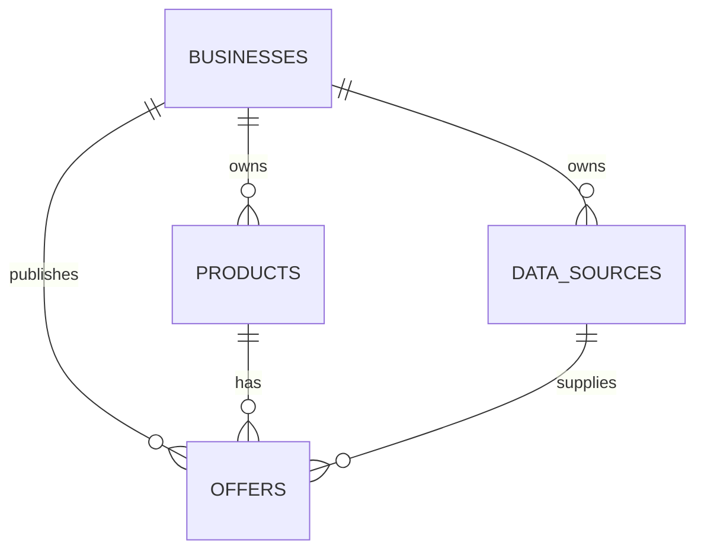

# TerminalWay — Database Documentation

Version 1.0 · 13 October 2026

## Purpose

The database stores businesses, data sources, product catalogues and offers that the TerminalWay API and authorised agents will eventually query. This document describes the schema confirmed by PostgreSQL output in this session. An API, ingestion service and search engine have not yet been implemented.

## Environment

| Setting | Value |
|---|---|
| Service | Amazon Aurora PostgreSQL Serverless, Express configuration |
| Cluster | `terminalway-dev01` |
| Region | `eu-north-1` — Stockholm |
| Observed server version | PostgreSQL 17.9 |
| Database | `terminalway` |
| Schema | `core` |
| Administrative user used | `postgres` |
| Authentication | IAM with a temporary token |
| Port | `5432` |
| Endpoint | `terminalway-dev01.cluster-cd2gwcuy4tcm.eu-north-1.rds.amazonaws.com` |
| Observed connection | TLS 1.3 |

The final instance identifier has not been confirmed. The Express creation form showed a minimum of 0 ACU, a maximum of 4 ACUs and automatic pause after 300 seconds. A maximum of 1 ACU was recommended, but the final applied settings have not been verified. The form also specified internet access, no customer VPC and encryption using an AWS/RDS-managed key.

The cluster is the Aurora infrastructure. `terminalway` is the PostgreSQL database within it. `core` is the namespace that organises the tables.

## Relationships



A business can have multiple sources, products and offers. Each offer references one business, one product and one source. Composite foreign keys ensure that the product and source belong to the business associated with the offer.

A product does not directly reference a source. Source attribution currently occurs through offers; the provenance of individual catalogue fields is not recorded yet.

## Conventions

- IDs are UUIDs generated using `gen_random_uuid()`.
- Dates use `TIMESTAMPTZ`, which represents an instant and displays it in the session's time zone.
- `created_at` and `updated_at` default to `now()` on insertion. **There is no trigger that automatically refreshes `updated_at`.**
- `metadata` fields contain JSONB objects and default to `{}`.
- Monetary values use `NUMERIC` to avoid floating-point rounding errors.
- Fields without `NOT NULL` can contain an unknown value (`NULL`).

## `core.businesses` — Businesses

| Field | Type | Required | Rule / meaning |
|---|---|---|---|
| `id` | UUID | Yes | Primary key; generated automatically |
| `name` | TEXT | Yes | Name; cannot consist only of spaces |
| `legal_name` | TEXT | No | Registered business name |
| `website` | TEXT | No | Website; the database does not validate URL format |
| `country_code` | VARCHAR(2) | No | Two uppercase letters; for example, `GB` |
| `status` | TEXT | Yes | `active` or `inactive`; defaults to `active` |
| `metadata` | JSONB | Yes | JSON object; defaults to `{}` |
| `created_at` | TIMESTAMPTZ | Yes | Creation time; defaults to `now()` |
| `updated_at` | TIMESTAMPTZ | Yes | Update time; defaults to `now()` |

Index: primary key on `id`. Names, registered names and websites are not unique; multiple businesses may share a name. The country constraint checks format only, rather than membership in an official country-code list.

## `core.data_sources` — Data Sources

This is an application table created for TerminalWay, not a PostgreSQL integration service. It records where a business supplies data from. A separate ingestion program will retrieve and import that data.

| Field | Type | Required | Rule / meaning |
|---|---|---|---|
| `id` | UUID | Yes | Primary key; generated automatically |
| `business_id` | UUID | Yes | References `businesses.id` |
| `name` | TEXT | Yes | Source name; cannot consist only of spaces |
| `source_type` | TEXT | Yes | One of the types listed below |
| `status` | TEXT | Yes | `active` or `inactive`; defaults to `active` |
| `last_successful_sync_at` | TIMESTAMPTZ | No | Most recent successful synchronisation |
| `metadata` | JSONB | Yes | Non-secret configuration; defaults to `{}` |
| `created_at` | TIMESTAMPTZ | Yes | Defaults to `now()` |
| `updated_at` | TIMESTAMPTZ | Yes | Defaults to `now()` |

Allowed source types: `api`, `csv`, `excel`, `shopify`, `woocommerce`, `sql`, `pos`, `manual`.

Indexes and constraints:

- Primary key on `id`.
- Unique `(business_id, name)`: source names cannot be repeated within the same business.
- Explicit index on `business_id`.
- Unique `(business_id, id)`, added to support the composite foreign key from offers.

Do not store passwords, tokens or API keys in `metadata`. Integration credentials should be held in a secrets manager, with only a reference stored in the source record.

## `core.products` — Per-Business Catalogue

Each record represents a product in one business's catalogue. This is not yet a globally normalised catalogue shared across businesses.

| Field | Type | Required | Rule / meaning |
|---|---|---|---|
| `id` | UUID | Yes | Primary key; generated automatically |
| `business_id` | UUID | Yes | References `businesses.id` |
| `sku` | TEXT | Yes | Internal product code; cannot consist only of spaces |
| `name` | TEXT | Yes | Product name; cannot consist only of spaces |
| `description` | TEXT | No | Description |
| `brand` | TEXT | No | Brand |
| `gtin` | TEXT | No | Trade item identifier; format and check digit are not validated |
| `category` | TEXT | No | Free-text category; no normalised taxonomy |
| `status` | TEXT | Yes | `active` or `inactive`; defaults to `active` |
| `metadata` | JSONB | Yes | Additional attributes; defaults to `{}` |
| `created_at` | TIMESTAMPTZ | Yes | Defaults to `now()` |
| `updated_at` | TIMESTAMPTZ | Yes | Defaults to `now()` |

Indexes: primary key on `id`, unique `(business_id, sku)` and unique `(business_id, id)`.

Different businesses may use the same SKU. The uniqueness constraint does not normalise letter case or automatically trim spaces. The composite index beginning with `business_id` supports queries filtered by business.

## `core.offers` — Prices and Availability

Each record represents a product offer supplied by a source. A product can have multiple offers, distinguished by their source and external identifier.

| Field | Type | Required | Rule / meaning |
|---|---|---|---|
| `id` | UUID | Yes | Primary key; generated automatically |
| `business_id` | UUID | Yes | Business owning the offer |
| `product_id` | UUID | Yes | Product belonging to the same business |
| `source_id` | UUID | Yes | Source belonging to the same business |
| `external_id` | TEXT | Yes | Offer identifier in the source; cannot be blank |
| `price` | NUMERIC(18,4) | Yes | Non-negative price; no currency conversion |
| `currency` | VARCHAR(3) | Yes | Three uppercase letters; for example, `GBP` |
| `stock_quantity` | NUMERIC(18,3) | No | Non-negative quantity; fractional quantities allowed |
| `availability` | TEXT | Yes | Values below; defaults to `unknown` |
| `source_updated_at` | TIMESTAMPTZ | No | When the source updated the information |
| `ingested_at` | TIMESTAMPTZ | Yes | When the information was received; defaults to `now()` |
| `expires_at` | TIMESTAMPTZ | No | Validity deadline defined by the application |
| `created_at` | TIMESTAMPTZ | Yes | Defaults to `now()` |
| `updated_at` | TIMESTAMPTZ | Yes | Defaults to `now()` |

Allowed availability values: `in_stock`, `out_of_stock`, `preorder`, `unknown`.

A `NULL` stock quantity means the quantity is unknown; zero means no units. There is no constraint that automatically reconciles `stock_quantity` with `availability`.

### Integrity and Indexes

| Rule | Purpose |
|---|---|
| FK `business_id → businesses.id` | The business must exist |
| FK `(business_id, product_id) → products(business_id, id)` | The product must belong to the business |
| FK `(business_id, source_id) → data_sources(business_id, id)` | The source must belong to the business |
| UNIQUE `(business_id, source_id, external_id)` | Prevents duplicate source offers within a business |
| Index `(business_id, product_id)` | Retrieves a product's offers within a business |
| Index `(business_id, source_id)` | Retrieves a source's offers within a business |

Currency format is checked, but there is no official currency-code lookup. The database does not enforce date ordering. Expired offers remain stored and must be filtered by queries. Ingestion updates must explicitly refresh `ingested_at`; its default applies only when inserting a record.

## Querying the Catalogue and Valid Offers

```sql
SELECT
    b.id AS business_id,
    b.name AS business,
    p.sku,
    p.name AS product,
    s.name AS source,
    o.price,
    o.currency,
    o.stock_quantity,
    o.availability,
    o.source_updated_at,
    o.ingested_at,
    o.expires_at
FROM core.offers o
JOIN core.businesses b ON b.id = o.business_id
JOIN core.products p
  ON p.business_id = o.business_id AND p.id = o.product_id
JOIN core.data_sources s
  ON s.business_id = o.business_id AND s.id = o.source_id
WHERE b.status = 'active'
  AND p.status = 'active'
  AND s.status = 'active'
  AND (o.expires_at IS NULL OR o.expires_at > now());
```

This query includes offers with unknown availability or no stock. To return only offers explicitly marked as available, add `AND o.availability = 'in_stock'`. A `NULL` expiry does not prove freshness; the validity policy must define how to handle such offers.

## Development Example

The latest supplied script replaced the Brazilian sample with this fictional English-language record. The user indicated execution, but the final query output was not provided.

| Entity | Data |
|---|---|
| Business | `TerminalWay Demo`, country `GB` |
| Source | `Test catalogue`, type `manual` |
| Product | SKU `DEMO-001`, `Coffee beans 500 g`, brand `Demo Brand`, category `Food` |
| Offer | External ID `DEMO-OFFER-001`, price `7.90 GBP`, stock `20`, availability `in_stock` |
| Validity | 24 hours after insertion of the sample |

## Connecting Through CloudShell

An IAM-authenticated CloudShell connection was established successfully. The temporary token depends on the AWS permissions of the session. Do not save tokens in files, repositories or Terraform state.

The connection used `sslmode=require`, which encrypts traffic. To also verify the server's identity, use `sslmode=verify-full` with the official RDS CA certificate and the correct hostname.

After connecting:

```psql
\connect terminalway
\dt core.*
\d core.businesses
\d core.data_sources
\d core.products
\d core.offers
```

## Deletion and Maintenance

Foreign keys do not use `ON DELETE CASCADE`. To remove a business with related records, delete its offers first, then its products and sources, and finally the business. Use a transaction for related operations.

Maintain versioned SQL migrations for future schema changes. Terraform manages AWS infrastructure; PostgreSQL tables are maintained through migrations. The Terraform package prepared in this session still requires generation and validation of the live cluster configuration before import.

## Current Limitations and Next Steps

1. Automate `updated_at` and define synchronisation and freshness rules.
2. Create an application user with specific permissions; `postgres` was used for administrative setup.
3. Implement isolation between businesses in the application and evaluate Row Level Security. Foreign keys enforce integrity, but do not prevent an authorised database user from reading another business's records.
4. Implement ingestion services and data normalisation. The source table does not execute integrations.
5. Record ingestion history and catalogue-field provenance. There is no complete provenance trail or price history yet.
6. Model shops, locations, channels, variants, services and promotions according to the first use case.
7. Build the API and textual/semantic search. Relational B-tree indexes exist, but a dedicated search index has not been implemented.
8. Verify backups, capacity, automatic pause and AWS permissions; test restoration before production.

The current database is the initial prototype structure. It does not yet implement reservations, payments, commercial transactions or agent access control.
